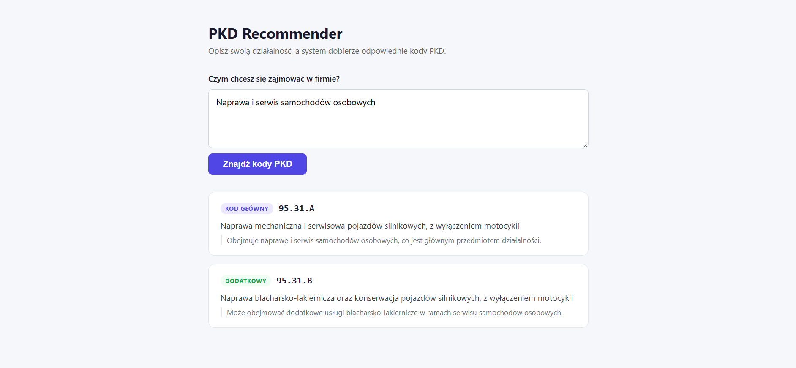

# PKD Recommender



A web application that helps Polish entrepreneurs find the right PKD codes (Polska Klasyfikacja Działalności — Polish Classification of Activities) based on a natural language description of their business.

## How it works

The user types a description of their business activity and the system:

1. Converts the description into an embedding vector (model `BAAI/bge-m3`)
2. Searches for semantically similar PKD codes in the Qdrant vector database
3. Sends the candidates to an LLM, which selects the best matching codes and generates justifications

## Stack

- **Backend:** Python, FastAPI
- **Vector database:** Qdrant (Docker)
- **Embeddings:** `sentence-transformers` / `BAAI/bge-m3`
- **LLM:** local [Ollama](https://ollama.com) (`llama3.1:8b` by default)
- **Frontend:** Vue 3 + Vite
- **Server:** VPS with Nginx as reverse proxy

## Project history

The project started locally with **Ollama** running `llama3.1:8b` on my own machine. After deploying to a **VPS without a GPU**, local model inference took 1–3 minutes per request, which was unacceptable.

The solution was to replace the local LLM with the **Groq API** — the free tier provides ~14,400 requests per day and response time dropped to 1–3 seconds. The model was also upgraded to `llama-3.3-70b-versatile`, which at a comparable response time is significantly more accurate than the local `llama3.1:8b`.

The project has since moved back to a local **Ollama** model, so no external API is needed and user descriptions never leave the server. The model is configurable via `MODEL_LLM`; on a CPU-only machine expect responses to take much longer than with a hosted API.

## Setup

### Requirements

- Python 3.11+
- Node.js 18+
- Docker
- [Ollama](https://ollama.com/download)

### Installation

```bash
# Start Qdrant
docker compose up -d

# Pull the LLM
ollama pull llama3.1:8b

# Backend
pip install -r requirements.txt

# Optional: override defaults (Qdrant/Ollama host, models)
cp .env.example .env

# Frontend
cd frontend
npm install
npm run build
```

### Preparing the PKD database

Before the first run, PKD codes need to be indexed in Qdrant. There are two source JSON files:

- **`pkd.json`** — raw list of all PKD codes with their official names in the format `{"code": "XX.XX.X", "description": "..."}`. The starting point for the entire pipeline.

- **`pkd_augmented.json`** — an enriched version of `pkd.json`. Each code additionally has `keywords` (natural language keywords, synonyms, colloquial names) and `examples` (sample sentences describing the business activity). The enrichment was generated by a local LLM (Ollama `llama3.1:8b`) and significantly improves semantic search quality — the embedding model matches user descriptions to PKD codes much more accurately.

```bash
# Step 1: generate pkd_augmented.json (requires local Ollama, one-time only)
python scripts/augment_pkd.py

# Step 2: index the codes into Qdrant (requires Docker running)
python scripts/ingest_pkd.py
```

> `pkd_augmented.json` is already included in the repository — step 1 can be skipped and you can go straight to indexing.

### Running the API

```bash
uvicorn api:app --host 0.0.0.0 --port 8000
```

> Run a single worker (the default — don't add `--workers`). Each worker loads its own copy of `BAAI/bge-m3` (~2 GB RAM), and the rate limiter keeps its counters in memory, so with multiple workers each one would enforce its own separate limit.

## Environment variables

| Variable | Description |
|---|---|
| `QDRANT_HOST` | Qdrant host (default: `localhost`) |
| `QDRANT_PORT` | Qdrant port (default: `6333`) |
| `QDRANT_COLLECTION` | Collection name (default: `pkd_codes`) |
| `MODEL_EMBED` | Embedding model (default: `BAAI/bge-m3`) — changing it requires re-running `ingest_pkd.py` |
| `OLLAMA_HOST` | Ollama server URL (default: `http://localhost:11434`) |
| `OLLAMA_TIMEOUT` | LLM request timeout in seconds (default: `300`) |
| `MODEL_LLM` | Ollama model (default: `llama3.1:8b`) — must be pulled first with `ollama pull` |
| `MODEL_AUGMENT` | Ollama model used by `scripts/augment_pkd.py` (default: same as `MODEL_LLM`) — a larger model gives better keywords/examples |

All variables are optional. Shared settings live in `config.py`, used by both the API and `scripts/ingest_pkd.py`.
